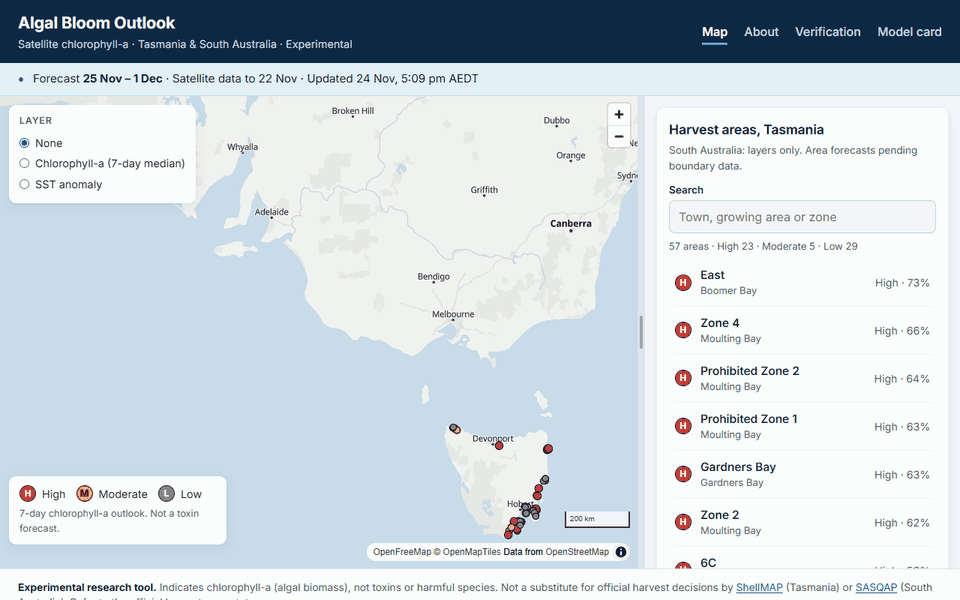
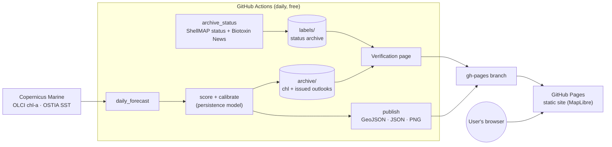
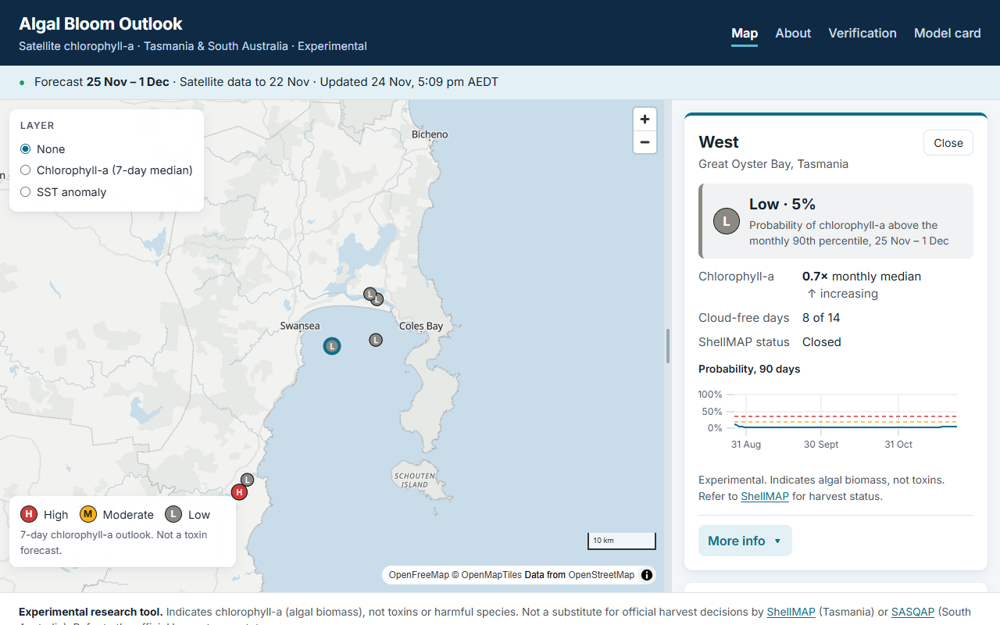
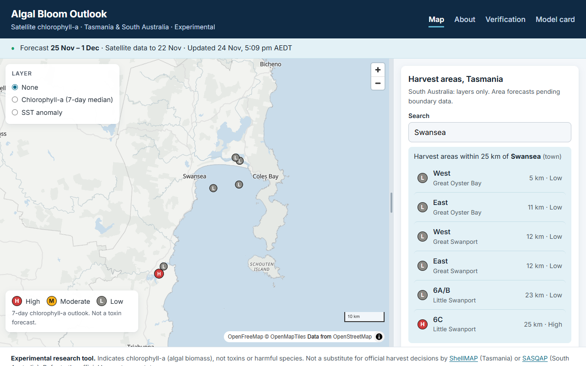
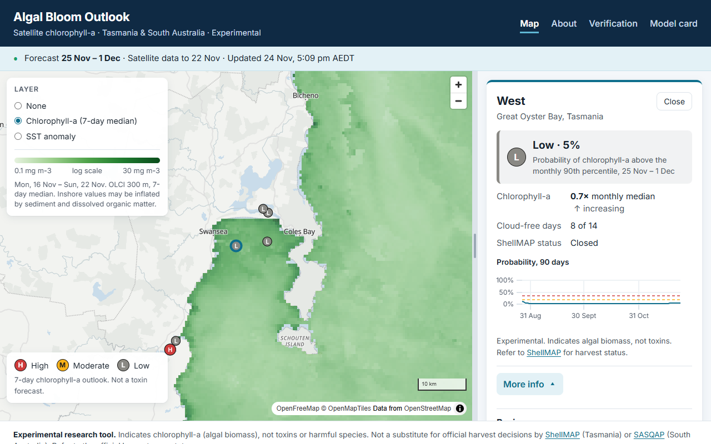
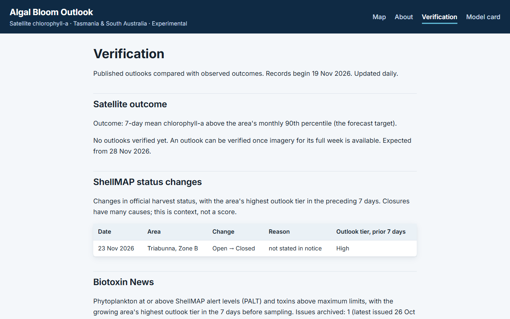
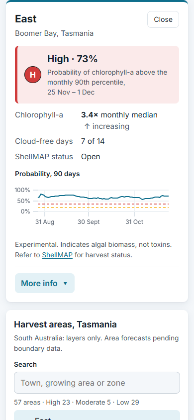

# Algal Bloom Outlook

**A free 7-day satellite chlorophyll-a outlook for Tasmanian shellfish harvest areas, updated daily.**

**Live site:** https://koiiphish.github.io/AlgalBloom/ · [](https://github.com/koiiphish/AlgalBloom/actions/workflows/ci.yml) [](https://github.com/koiiphish/AlgalBloom/actions/workflows/daily_forecast.yml)

> **Experimental research tool.** Indicates chlorophyll-a (algal biomass), not toxins or harmful species. Not a substitute for official harvest decisions by ShellMAP (Tasmania) or SASQAP (South Australia).



## Why this exists

Algal blooms close shellfish harvest areas and can kill farmed stock. The 2025 *Karenia* bloom in South Australia showed how quickly conditions can change. The official programs (ShellMAP, SASQAP) test water and flesh, and publish the **current** harvest status. They do not publish an outlook. Meanwhile, satellites measure chlorophyll-a over every lease almost daily, for free. This project asks a narrow question: **how much can a free, transparent, honestly evaluated satellite outlook add, at zero running cost?**

## What it shows

- **A tier for each of 57 Tasmanian harvest areas** (High / Moderate / Low): the probability that the area's chlorophyll-a will exceed its own monthly 90th percentile over the next 7 days.
- **Evidence for each area:** chlorophyll relative to its monthly median, the trend, cloud-free days, the official ShellMAP status, and a 90-day record.
- **Map layers:** 7-day chlorophyll-a and sea surface temperature (SST) anomaly, for Tasmania and South Australia.
- **Town search:** for example, "Devonport" lists the harvest areas within 25 km.
- **[Verification](https://koiiphish.github.io/AlgalBloom/verification.html):** each published outlook is compared with what the satellite later observed, with official status changes, and with the weekly Biotoxin News results.

It is **not** a toxin forecast. Some toxic species, such as *Alexandrium* and *Dinophysis*, cause problems at low biomass without raising chlorophyll.

## How it works

1. **Every day**, a scheduled GitHub Actions job downloads the newest Copernicus Sentinel-3 OLCI chlorophyll-a at 300 m resolution, about 2 days behind real time.
2. For each harvest area plus a 2 km buffer, it takes the **median of the cloud-free pixels**.
3. It compares the result with the area's **2016–2022 median for that month**, and averages the last 14 days, giving partly cloudy days less weight.
4. A **calibrated logistic model** turns that score into a probability. The tier cut-offs are chosen so that, in ordinary weeks, only about 20% of areas are flagged Moderate or above and 5% are flagged High.
5. The job publishes **small static files** (GeoJSON, JSON, PNG) to GitHub Pages. The website reads them directly: there is no server and no running cost.



## Results (honest version)

The model was **trained on 2016–2022, tuned and calibrated on 2023, and scored once on 2024–2026**, after everything was frozen. PR-AUC is the score to compare, and random guessing scores the bloom-week rate.

| Method | PR-AUC | Brier |
|---|---|---|
| **Persistence of recent chlorophyll (shipped)** | **0.555** | **0.126** |
| Seasonal climatology | 0.171 | 0.155 |
| Copernicus BGC model (given perfect hindsight) | 0.152 | 0.150 |
| Gradient boosting with weather, SST and currents | 0.370 | 0.136 |
| *Random guessing (bloom-week rate)* | *0.181* | – |

- **Persistence beats every baseline in each test year**, but its skill is modest in ordinary years (2024: 0.17 vs a rate of 0.12; 2025: 0.16 vs 0.09). A long high-chlorophyll period in 2026 lifts the pooled score.
- **Adding weather, SST and currents did not help.** In year-by-year tests, the boosted model was worse than persistence in 2 years, tied in 3 and better in 1, so the simpler method shipped.
- **Harmful species, Maria Island:** Moderate or High was flagged before **64%** of visits with a harmful-species alert, **and before 64% of visits without one**. So there is no discrimination: chlorophyll is a biomass proxy.
- **South Australia, out of region:** applied unchanged to Gulf St Vincent, the outlook went **High 11 days before the 113,000 cells/L *Karenia* sample** of 3 July 2025. That is one bloom at one station.

Full detail: [model card](docs/model_card.md), [decision log](docs/decisions.md).

## Limitations

- **A proxy, not a toxin forecast.** Low does not mean the absence of harmful species.
- **It reacts; it doesn't predict onsets.** It says "conditions have been unusual and are likely to stay so".
- **Coastal satellite chlorophyll is optically contaminated.** Sediment and tannins after rain can read as chlorophyll.
- **About one-third of area-days are cloud-free.** After 14 cloudy days, an area shows its seasonal baseline probability.
- **Areas are shown as points.** The boundary polygons are not published until theLIST confirms their licence. Each area links to its official ShellMAP map instead.
- **South Australia has map layers only**, until PIRSA's harvest-area boundaries are available.

## Screenshots

| Area panel | Town search | Chlorophyll layer |
|---|---|---|
|  |  |  |

| Verification | Phone |
|---|---|
|  |  |

Screenshots captured from the live site on 24 Nov 2026 with `tools/screenshots.mjs`.

## Run it yourself

Requirements: [uv](https://docs.astral.sh/uv/), a free [Copernicus Marine](https://marine.copernicus.eu/) account, and Node.js (optional, for the JavaScript checks and screenshots).

```bash
uv sync                                   # Python 3.12 environment, exact pinned versions
cp .env.example .env                      # then add your Copernicus Marine login (never commit it)
uv run pytest -q && uv run ruff check .   # tests and lint

# One forecast, written to _site/ (no archive update), then preview it
uv run python -m pipeline.forecast.daily --site _site
uv run python -m http.server -d _site 8000
```

- The daily job needs each area's satellite pixels. Build them once from the theLIST polygons with `uv run python -m pipeline.forecast.area_pixels --export`.
- **GitHub Actions secrets:** `COPERNICUSMARINE_SERVICE_USERNAME`, `COPERNICUSMARINE_SERVICE_PASSWORD`, and `TAS_AREA_PIXELS` (the exported pixel list).
- Rebuilding the training history and model is documented phase by phase in [`docs/decisions.md`](docs/decisions.md) (D006–D016).

## Repository layout

| Path | Contents |
|---|---|
| `pipeline/` | Python package: `fetch/`, `features/`, `labels/`, `model/`, `forecast/` (daily job), `publish/` (site files) |
| `web/` | Static site: HTML, CSS, vanilla JS modules; MapLibre, uPlot and Inter vendored |
| `labels/` | Committed archive of official status snapshots, Biotoxin News issues, harmful-species events |
| `archive/` | Committed daily chlorophyll stats and every published outlook |
| `models/` | Deployed calibration, baselines, thresholds, SST climatology, evaluation results |
| `docs/` | Decision log, data sources and licences, model card, About page, progress |
| `tools/` | Screenshot and GIF scripts for this README |
| `.github/workflows/` | `ci`, `archive_status`, `daily_forecast`, `publish_web` |

## Data sources

- **Copernicus Marine Service:** "Generated using E.U. Copernicus Marine Service Information". OLCI chlorophyll ([10.48670/moi-00278](https://doi.org/10.48670/moi-00278), [moi-00280](https://doi.org/10.48670/moi-00280)) and OSTIA SST ([moi-00165](https://doi.org/10.48670/moi-00165), [moi-00168](https://doi.org/10.48670/moi-00168)).
- **NRE Tasmania (ShellMAP):** harvest status, Biotoxin News and management plans, © State of Tasmania, non-commercial use.
- **theLIST:** harvest-area locations derived from it, © State of Tasmania.
- **IMOS:** phytoplankton counts (evaluation), CC BY 4.0.
- **Open-Meteo:** ERA5 weather (model testing only), CC BY 4.0.
- **OpenStreetMap:** basemap via OpenFreeMap, and place names (ODbL).

Full licence notes: [`docs/data_sources.md`](docs/data_sources.md).

## Next steps

- **South Australia:** add area outlooks once PIRSA provides harvest-area boundaries. The method suits SA's high-biomass *Karenia* blooms better than Tasmania's low-biomass toxic species.
- **Species-aware outlook:** request ShellMAP's historical phytoplankton monitoring data, and test Copernicus's dinoflagellate product when it can be subset.
- **Rolling recalibration and retraining** on the archive of published outlooks, once it holds a year of data.
- **Alerts:** optional email or RSS when an area changes tier. That needs a free delivery option first.
- **More states.**

## Licence

**No licence is granted.** The code and content are © the author, all rights reserved: you may view them here, but not reuse them without permission. Data remain under their providers' licences listed above.
